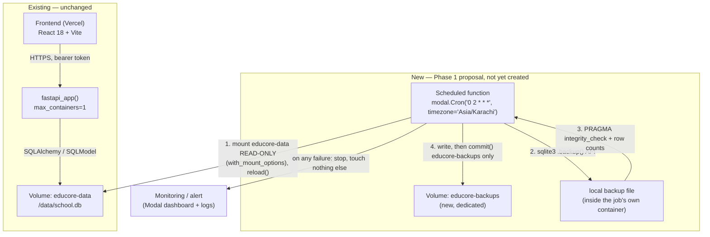

# EduCore AI — Phase 1: Database Protection & Backup Implementation Plan

**Status (updated 2026-11-14): implemented and live. Phases 1a and 1b are in the code, and the backup job has been running on Modal since 2026-11-13. The text below is the original plan, kept for its reasoning; for day-to-day steps use DEPLOYMENT_GUIDE.md, "Backups and restoring".**

**Date:** 2026-11-13 (Revision 2 — supersedes the first draft, approved in principle, now revised for timezone, Volume concurrency, the restore procedure, and the retention algorithm, per your explicit feedback). **Repository state inspected:** branch `mvp/m10-qa`, commit `f9114ab`. **Scope:** Phase 1 of database reliability — automated backups, commit strategy, and disaster recovery for the existing SQLite-on-Modal-Volume architecture. No architecture change, no new database engine, no hosting change.

**What changed in this revision, at a glance:**
- §6 is rewritten as a precise, step-by-step answer to how the backup job and `fastapi_app()` actually interact on the same Volume — reload semantics, read-only mounting, and the real scope of `max_containers=1` — each claim separately marked VERIFIED or ASSUMPTION.
- §7.2's retention algorithm is now full pseudocode, with the Karachi-timezone pitfall made explicit, and an honest limitation noted (a failed run on a weekly/monthly day is skipped, not backfilled).
- §10 is rewritten as eight explicit, ordered steps, each naming the exact Modal CLI/SDK call involved, including one genuine, unresolved gap in Modal's own public documentation that this plan deliberately works around rather than papering over.
- The Cron schedule now explicitly specifies `timezone="Asia/Karachi"`, verified by actually constructing it against the installed SDK, not assumed by analogy.

Every factual claim is still marked **VERIFIED**, **RECOMMENDATION**, or **ASSUMPTION**, exactly as before. Nothing is asserted as working until it says so.

---

## 1. Executive Summary

Unchanged in substance from the approved first draft: reuse `migrate_db.py`'s existing, correct SQLite backup code, run it on a Modal-scheduled daily job, write to a new dedicated `educore-backups` Volume, keep `max_containers=1` and the request path untouched. This revision adds the precision you asked for on four points before any of it is built: the schedule must fire at true Pakistan local time; the backup job's safety does not come from the SQLite Online Backup API alone, but from how Modal Volumes mount and commit; the restore procedure now names the exact supported command for every one of your eight required steps; and the retention algorithm is now specified precisely enough to implement without ambiguity.

**Nothing in this document is to be implemented without your separate, explicit approval.**

---

## 2. Existing Database Architecture

*(Unchanged from the approved draft — re-stated for continuity.)*

**VERIFIED**, from [backend/config.py](backend/config.py), [backend/database.py](backend/database.py), [backend/modal_app.py](backend/modal_app.py):

- SQLite via SQLModel/SQLAlchemy, default rollback-journal mode (no WAL pragma set) — [database.py:8-9](backend/database.py:8).
- `DATABASE_URL` → `sqlite:////data/school.db` on Modal ([modal_app.py:65-66](backend/modal_app.py:65)).
- No `attendance` table or feature exists anywhere in this codebase — confirmed again in this revision; still a correction to the original brief, not a gap this plan fills.
- Thirteen write (`session.commit()`) sites, in five files: [routers/students.py](backend/routers/students.py) (4), [routers/fees.py](backend/routers/fees.py) (2), [routers/results.py](backend/routers/results.py) (2), [routers/auth.py](backend/routers/auth.py) (3), [services/admin_setup.py](backend/services/admin_setup.py) (2) — all reached through the single [database.py:36-38](backend/database.py:36) `get_session()` dependency.
- `migrate_db.py` already contains a correct SQLite backup, via Python's `sqlite3.Connection.backup()` — [migrate_db.py:175-180](backend/migrate_db.py:175). This plan still reuses it rather than inventing a new technique.

---

## 3. Verification of Current Modal Volume Configuration

*(Unchanged — re-verified against the same file, no drift since the first draft.)*

| Audit claim | Verdict |
|---|---|
| Volume `educore-data`, mounted at `/data` | **VERIFIED** — [modal_app.py:31](backend/modal_app.py:31), [:50](backend/modal_app.py:50) |
| `DATABASE_URL=sqlite:////data/school.db` | **VERIFIED** — [modal_app.py:65-66](backend/modal_app.py:65) |
| `max_containers=1` on `fastapi_app()` | **VERIFIED** — [modal_app.py:54](backend/modal_app.py:54) |
| No explicit `.commit()` on the live request path | **VERIFIED** — only `seed_database_volume()` and `upgrade_database()` call `.commit()`, never `fastapi_app()` |
| No routine/scheduled backup exists today | **VERIFIED** — no `Cron`, `Period`, or `schedule=` anywhere in the repository |
| Modal SDK itself is unpinned | **VERIFIED** — `pip install modal` with no version in any requirements file; this revision's research used a freshly installed `modal==1.6.4` |

---

## 4. Current Database Persistence Risks

*(Unchanged from the approved draft.)*

| Risk | Status | Severity |
|---|---|---|
| Two containers writing to `school.db` at once | Theoretical — actively prevented by `max_containers=1` *for `fastapi_app()` specifically* (§6.4 now addresses exactly how far this protection extends) | Would be Critical |
| A write lost on an abrupt (non-graceful) crash | Confirmed gap in source; not reproduced | Medium |
| No independent backup exists | Confirmed | High |
| No automated integrity check runs on a schedule | Confirmed | Medium-High |

---

## 5. Modal Backup and Snapshot Options

*(Core content unchanged from the approved draft — definitions of commit vs. snapshot vs. independent backup vs. restore, and the evaluated methods, all still hold. One addition below.)*

### 5.1 Timezone — revised and now explicitly verified

**Your requirement:** the daily backup must run at 02:00 **Pakistan local time**, not UTC or the container's default.

- **VERIFIED, from the installed SDK's own docstring** (`inspect.getdoc(modal.Cron.__init__)`): *"timezone: IANA timezone name; defaults to UTC."* `Asia/Karachi` is a standard IANA timezone name (UTC+5 year-round — Pakistan does not observe daylight saving time).
- **VERIFIED by actually constructing it**, not just reading the docstring: `modal.Cron("0 2 * * *", timezone="Asia/Karachi")` built successfully against the real, installed `modal==1.6.4` package in this session. Separately confirmed Python's own `zoneinfo.ZoneInfo("Asia/Karachi")` resolves to a fixed `+05:00` offset right now, consistent with Pakistan having no DST.
- **A real caveat, also verified by testing, not by reading docs:** `modal.Cron`'s constructor performs **no validation** of the timezone string at all — passing a nonsense value like `"Not/ARealZone"` was accepted silently, with no error. This means a typo in the timezone string would not be caught until the schedule actually misfires (or, per Modal's docs, is inspectable on the App's dashboard after deployment). **RECOMMENDATION:** after deploying, check the schedule's configured timezone on Modal's own dashboard (`modal app info` / the dashboard's schedule view) before trusting the first real run, rather than assuming construction-time success means correctness.
- **The exact proposed schedule definition:**
  ```python
  @app.function(
      schedule=modal.Cron("0 2 * * *", timezone="Asia/Karachi"),
      volumes={
          "/data": data_volume.with_mount_options(read_only=True),   # see §6.3
          "/backups": backup_volume,
      },
      secrets=[modal.Secret.from_name("educore-secrets")],
      timeout=300,
  )
  def daily_backup():
      ...
  ```
  `"0 2 * * *"` is standard cron syntax for 02:00, every day, interpreted in the `timezone=` given — **VERIFIED against `modal.Cron`'s own documented example style** (`modal.Cron("5 4 * * *")  # run at 4:05am UTC every night` — the docs' own comment confirms the cron string's hour is read in whatever timezone is configured, UTC by default, Asia/Karachi here).
- **Activation, verified from Modal's docs:** the schedule only becomes active once the App is deployed (`modal deploy`); it does not run under `modal run` or local testing. *"Now the function will run every day, at the time of the initial deployment, without any further interaction on your part."* Also verified: **`modal.Cron` does not reset on redeploy** (unlike `modal.Period`, which does) — the right choice here, since this app will be redeployed for unrelated reasons far more often than once a day, and a `Period`-based schedule would drift every time.

---

## 6. Modal Volume Concurrency and Consistency — rewritten, in full

This section exists because you were right to ask for it: **the SQLite Online Backup API protects the integrity of one file as seen by one connection. It says nothing about how two separate Modal containers, each with their own mount of the same Volume, see each other's data.** Those are two different problems, solved by two different mechanisms, and this plan needs both.

### 6.1 How does the backup job access `educore-data` while `fastapi_app()` is running?

**VERIFIED, from Modal's own documentation (`modal.com/docs/guide/volumes`) and the installed SDK:**

- Each container that mounts a Volume gets its own, independent, local view of that Volume's filesystem. *"At container creation time the latest state of an attached Volume is mounted."* This means: when the backup job's container starts, it receives whatever was the **most recently committed** state of `educore-data` at that moment — not a live, shared filesystem with `fastapi_app()`'s container.
- These two containers (the long-running `fastapi_app()` one and the short-lived daily backup one) are **completely separate processes on separate local filesystem views**. The backup job never reads `fastapi_app()`'s in-memory or not-yet-committed state, because that state simply isn't visible outside `fastapi_app()`'s own container until *that* container commits it.
- `data_volume.reload()`, called inside the backup job before reading, additionally re-syncs that job's view to whatever is the **latest committed** state *as of the moment of the reload call* — relevant mainly if the backup job's container happens to be a warm/reused one from a previous run rather than freshly started, or simply as defensive best practice. **VERIFIED**: *"you need to explicitly reload the Volume to see changes made since it was first mounted."*

**Answer to your precise question:** the backup job accesses `educore-data` through its own independent container mount, which Modal's platform populates with the latest *committed* snapshot at mount/reload time — it is never looking at `fastapi_app()`'s live, in-progress state.

### 6.2 Does the backup job see only committed data? Two different senses of "committed," both answered.

This needs separating into two layers, because conflating them is exactly the mistake you told me not to make.

- **Volume-level commit (Modal's concept):** **VERIFIED** — a container's local writes become visible to *other* containers only after that container calls `.commit()` (or on automatic background/shutdown commit). The backup job, reading through its own mount, can only ever see a state that `fastapi_app()`'s container has already pushed with `.commit()` — never a half-written, in-flight local change from the other container. This is **structurally guaranteed by the mount model itself**, independent of anything SQLite does.
- **SQLite-level transaction commit (a separate fact, about SQLite, not Modal):** **VERIFIED, general SQLite behavior, independently of Modal** — SQLite's rollback-journal mechanism guarantees that the `school.db` file on disk, read by any process, is always in one of exactly two states outside of an in-progress write: the state before a transaction, or the state fully after it. There is no "half-committed" state written to disk during normal operation (only during a crash mid-fsync, which is the already-documented abrupt-crash risk, unrelated to this backup job). So the file that a Modal Volume commit pushes to durable storage is, outside that narrow crash window, always a SQLite-consistent file — it just isn't necessarily the *very latest* SQLite transaction if a Volume-level commit hasn't happened yet.
- **Net effect:** what the backup job reads is always (a) a Modal-committed state, which is always (b) a SQLite-consistent file, but possibly a few seconds *behind* the absolute latest write, bounded by Modal's own background-commit cadence (every few seconds, per the docs already quoted in the first draft). **This is exactly why the SQLite Online Backup API alone does not solve Volume synchronization — it guarantees the copy of whatever file it's given is internally consistent; it says nothing about which point-in-time version of that file the backup container was even looking at. The Volume's own commit/mount model is what answers that second question, and the two together are what make this safe, not either alone.**

### 6.3 What happens if `fastapi_app()` commits while the backup job is running?

**VERIFIED by reasoning precisely from the documented mount model, not assumed:** nothing happens to the backup job's in-progress read. The backup job's container has its own local, independent view, fixed as of its own last mount/reload. A commit from `fastapi_app()`'s container updates the Volume's *durable store* and becomes visible to *other* containers only when *they* next reload — the backup job, mid-copy, has no reason to reload again and will not see that new commit appear mid-operation. Its SQLite Online Backup API call is running against a local file that does not change under it during the copy, from its own point of view. **The real risk this plan must avoid is the opposite direction: a write from the backup job's side being silently overwritten by `fastapi_app()`'s next automatic commit** — which is exactly why §6.3-below (read-only mount) and §10 (stop before restoring) exist: the backup job is designed to **never write to `educore-data` at all**, so this direction of the risk never arises for routine backups; it only becomes relevant for the restore procedure in §10, which is handled by stopping `fastapi_app()` first.

### 6.4 Does the backup function require a read-only mount?

**Not strictly required by Modal's locking model, but now specified as enforced, not just promised, in this revision.**

- **VERIFIED, directly from the installed SDK's docstring for `Volume.with_mount_options`:** it supports exactly this use case, with a `@app.function` example in the docs themselves (not merely a Sandbox example, which is what the first draft could only partially confirm):
  ```python
  volume = modal.Volume.from_name("my-volume")

  @app.function(volumes={"/mnt": volume.with_mount_options(read_only=True)})
  def f():
      return os.mkdir("/mnt/foo")  # not possible!
  ```
- **RECOMMENDATION, now part of this plan's design, not optional:** the backup job mounts `educore-data` as `data_volume.with_mount_options(read_only=True)`. This makes an accidental write from the backup job's own code **physically fail at the OS level**, rather than relying on a promise that the code "just never calls `.commit()`." This is the concrete, supported mechanism that answers "specify a safe and technically supported approach" for this specific question.
- Why it isn't "required" by Modal's own concurrency rules: Modal's "last write wins" warning is specifically about two **writers**. A function that only reads is never a writer in that sense, with or without the read-only flag. The flag is defense-in-depth against a *bug* in the backup job's own code, not a requirement to avoid colliding with `fastapi_app()`.

### 6.5 Does `max_containers=1` protect `fastapi_app()` only, or every function touching the Volume?

**This is the single most important clarification in this revision, and the answer is: `max_containers=1` applies only to the one function it is set on — `fastapi_app()`. It is not a Volume-level or App-level lock.**

- **VERIFIED, directly from the installed SDK:** `max_containers` is a parameter of `@app.function(...)` itself (confirmed by inspecting `inspect.signature(modal.App.function)`, which lists `max_containers` alongside dozens of other per-function parameters). There is no equivalent setting on `modal.Volume`, and no App-wide "only one container total may touch this Volume" setting exists anywhere in the SDK.
- **Concrete consequence:** the new daily backup function, because it is a *separate* function from `fastapi_app()`, is **not** covered by `fastapi_app()`'s `max_containers=1` at all. If the backup job were ever (mis)written to write to `educore-data`, it could in principle run **concurrently** with `fastapi_app()`'s own container — exactly the two-writer scenario `max_containers=1` was put there to prevent, just on a different function.
- **This is precisely why §6.4's read-only mount matters, and why it is now a firm part of the design rather than a nice-to-have:** since Modal gives no Volume-level writer lock, the *only* real protection against the backup job ever becoming a second writer is (a) the code never calling `.commit()` on `educore-data`, enforced by (b) the read-only mount flag making that physically impossible even if (a) were ever violated by a future change. **Do not rely on `max_containers=1` to protect you from the backup job — it does not reach that far.**

### 6.6 Specified safe approach — summary

Putting §6.1–6.5 together, the backup job's access to `educore-data` is safe because of **three independent, stacked guarantees**, not because of the SQLite backup API alone:

1. **Mount isolation** (Modal, VERIFIED): the backup job's container has its own view, never sees `fastapi_app()`'s uncommitted state.
2. **Read-only enforcement** (Modal, VERIFIED API / RECOMMENDATION to use it): the backup job cannot become a writer even by accident.
3. **The SQLite Online Backup API** (already in this codebase, VERIFIED): guarantees the *copy it produces*, from whatever consistent file state it was handed by layer 1, is itself a valid, uncorrupted SQLite file.

None of the three alone is sufficient; the combination is the "safe and technically supported approach" you asked for.

---

## 7. Recommended Automated Backup Architecture

*(Unchanged in its overall shape from the approved draft; the Mermaid diagram, the two-tier storage idea, and the file list in the original §6/§6.1/§6.2 still apply. Reproduced here for continuity, now reflecting the read-only mount from §6.4.)*



Files that would need modification, new Modal resources, and the directory structure (§6.1/§6.2 of the first draft) are unchanged and restated in §14/§Summary below.

---

## 7a. Recommended Backup Schedule and Retention — algorithm, fully specified

### 7a.1 Is a plain file copy safe? (unchanged conclusion from the first draft, still holds)

No — SQLite's own on-disk consistency guarantee (§6.2) covers the file *plus its journal together*, not the file read in isolation by an unrelated copy process. The SQLite Online Backup API (already used by `migrate_db.py`) remains the correct tool, and §6 above adds the Volume-level reasoning that was previously missing.

### 7a.2 Retention tiers and the trade-off table

*(Unchanged from the first draft: 14 daily / 8 weekly / 12 monthly, storage cost negligible given a single school's SQLite file size and Modal's 1 TiB/month free Volume allowance.)*

### 7a.3 The algorithm — now specified precisely enough to implement, with every one of your five required properties addressed by name

```python
from datetime import datetime
from zoneinfo import ZoneInfo

KARACHI = ZoneInfo("Asia/Karachi")  # NOT the container's own system timezone -- see pitfall below
DAILY_KEEP, WEEKLY_KEEP, MONTHLY_KEEP = 14, 8, 12

def run_daily_backup_job():
    # --- Property: "consistent timezone handling" ---
    # A Modal container's bare `datetime.now()` returns the CONTAINER's system clock,
    # which defaults to UTC on Modal's Debian image (ASSUMPTION: Modal does not document
    # container OS timezone defaults explicitly; treat UTC as the base and always convert
    # explicitly, never rely on the container's local tz). The Cron schedule's
    # `timezone="Asia/Karachi"` only controls WHEN this function is *invoked* -- it does
    # NOT change what `datetime.now()` returns inside the function body. Every date decision
    # below therefore converts explicitly:
    now = datetime.now(KARACHI)
    stamp = now.strftime("%Y-%m-%d-%H%M")

    # --- Step 1: create and fully verify today's daily backup, BEFORE touching any tier ---
    local_copy = create_consistent_backup(source="/data/school.db")   # read-only mount, §6.4
    if local_copy is None:
        log_failure("backup creation failed"); alert(); return        # STOP. Nothing else runs.

    if not verify_backup(local_copy):       # PRAGMA integrity_check == 'ok'
        log_failure("integrity check failed"); alert(); return         # STOP. Nothing else runs.

    if not counts_plausible(local_copy):    # students/invoices/payments/results row counts
        log_failure("record counts look wrong"); alert(); return       # STOP. Nothing else runs.

    # Only a fully verified backup is ever written to educore-backups.
    daily_path = f"daily/school-{stamp}.db"
    upload_to_backups_volume(local_copy, daily_path)
    backup_volume.commit()                  # educore-backups ONLY -- educore-data is never written
    log_success(daily_path)

    # --- Step 2: tier promotion, only after the verified daily backup above is safely committed ---
    if now.weekday() == 0:                  # Monday, Karachi-local date
        weekly_path = f"weekly/school-{now.isocalendar()[0]}-week{now.isocalendar()[1]:02d}.db"
        copy_within_backups_volume(daily_path, weekly_path)
        backup_volume.commit()

    if now.day == 1:                        # first of the month, Karachi-local date
        monthly_path = f"monthly/school-{now.strftime('%Y-%m')}.db"
        copy_within_backups_volume(daily_path, monthly_path)
        backup_volume.commit()

    # --- Step 3: retention pruning, per tier, only for tiers just confirmed healthy this run ---
    prune_tier("daily", keep=DAILY_KEEP)
    if now.weekday() == 0:
        prune_tier("weekly", keep=WEEKLY_KEEP)
    if now.day == 1:
        prune_tier("monthly", keep=MONTHLY_KEEP)


def prune_tier(tier_dir, keep):
    files = list_files_in(f"{tier_dir}/", volume=backup_volume)        # educore-backups only
    files.sort(key=parse_timestamp_from_filename)                      # oldest -> newest
    excess = len(files) - keep
    if excess <= 0:
        return
    # --- Property: "does not accidentally delete the newest valid backup" / "never deletes
    #     the last known-good backup" --- the deletable slice is explicitly capped so that
    #     at least ONE file always survives in this tier, no matter what `keep` is set to.
    to_delete = files[: max(0, min(excess, len(files) - 1))]
    for f in to_delete:
        delete_from_backups_volume(f)       # educore-data is never referenced in this function at all
    if to_delete:
        backup_volume.commit()
```

**Each required property, named explicitly:**

| Your requirement | How the algorithm satisfies it |
|---|---|
| Consistent timezone handling | Every date decision (`stamp`, `weekday() == 0`, `day == 1`) derives from `datetime.now(ZoneInfo("Asia/Karachi"))`, computed once at the top and reused — never a bare, timezone-naive `datetime.now()`. |
| Does not accidentally delete the newest valid backup | `prune_tier`'s deletable slice is capped at `len(files) - 1`; the newest file in any tier is structurally unreachable by the delete loop. |
| Never deletes the last known-good backup | Pruning only runs *after* this run's new backup (if any) has already been verified and committed — so "the last known-good backup" entering the prune step is always either brand new or already proven good from a prior run, and the cap above still protects it either way. |
| Does not touch `educore-data` | Every write in `run_daily_backup_job` and `prune_tier` targets `backup_volume` (`educore-backups`) exclusively. `educore-data` is opened read-only (§6.4) and only ever read from, never written or committed. |
| Handles failed or incomplete backup runs safely | Any failure in creation, integrity check, or count check causes an immediate `return` **before** any tier promotion or pruning runs — a failed run leaves every existing backup, in every tier, completely untouched. |

**Honest limitation, flagged rather than hidden:** if the job fails specifically on a Monday or on the 1st of the month, that week's or month's dedicated weekly/monthly checkpoint is **skipped for that cycle, not backfilled** the next day — Phase 1's algorithm is deliberately simple (promote today's backup into a tier, or don't, based on today's date) rather than tracking "was last Monday's promotion missed." The daily tier around that date still provides a fallback recovery point. **RECOMMENDATION for Phase 2, not built now:** a small addition that checks "has this ISO week already got a weekly entry?" rather than strictly "is today Monday?" would close this gap if you want guaranteed weekly/monthly coverage; flagged here, not implemented, consistent with keeping Phase 1 minimal.

---

## 8. Explicit Volume Commit Strategy

*(Unchanged from the approved draft — no `volume.commit()` is added to the 13 existing write routes; the reasoning in the first draft's §8 still holds and is reinforced by §6.5 above: `max_containers=1` protects `fastapi_app()` alone, which is exactly why this plan is careful to keep the backup job from ever being a second writer, rather than leaning on that setting to cover it.)*

---

## 9. Backup Security

*(Unchanged from the approved draft.)*

---

## 10. Restore and Disaster Recovery Procedure — rewritten as eight explicit, ordered steps

**Still a procedure proposal. Nothing below has been executed. Per your own instruction, recovery is not claimed as working until it has actually been tested in isolation (§11).**

**One genuine gap in Modal's own public documentation, disclosed up front rather than papered over:** this revision specifically checked whether a file written to a Volume from *outside* a running container — via the CLI (`modal volume put`) or the SDK's local-usage functions (`batch_upload()`) — is immediately durable and visible without a separate `.commit()` call. **Modal's own docs do not say.** `Volume.commit()`'s own docstring states it *"must be called inside a container that mounts the Volume"* — meaning `.commit()` cannot even be invoked from the out-of-band path the CLI uses, and no page explains what, if anything, makes an out-of-band write durable instead. This plan does not assume an answer either way; step 4 below is designed specifically to not depend on trusting this undocumented behavior.

| # | Your required step | Exact Modal command/API | Notes |
|---|---|---|---|
| 1 | **Stop or disable production writes** | `modal app stop educore-ai-school-platform` | **VERIFIED, from `modal app stop --help`:** *"Permanently stop an App and terminate its running containers."* Modal has no finer-grained "reads OK, writes blocked" toggle — this is the only existing, zero-code tool that guarantees no container is running at all, so nothing can commit over the restore. It is a full outage for the duration of the restore, not writes-only; a true writes-only maintenance mode would need a small application code change and is flagged as a possible Phase 2 item, not built now. |
| 2 | **Preserve the existing database** | `modal volume cp educore-data school.db school.db.pre-restore-<timestamp>` | **VERIFIED command exists** (`modal volume cp --help`: *"Copy within a modal.Volume"*). Done entirely server-side, before anything else touches the volume, so the pre-restore state is never lost even if the next steps go wrong. |
| 3 | **Validate the selected backup** | `modal volume get educore-backups daily/school-<date>.db ./candidate.db` then, locally: `sqlite3 ./candidate.db "PRAGMA integrity_check;"` plus the same record-count comparison `migrate_db.py` already does ([migrate_db.py:194-211](backend/migrate_db.py:194)) | Fully offline, zero risk — this step touches neither `educore-data` nor the live app at all. Repeat with the next-older backup if this one fails either check. |
| 4 | **Restore into the existing `educore-data` Volume** | `modal volume put educore-data ./candidate.db school.db --force` | **VERIFIED command exists and supports overwrite** (`--force`, per `modal volume put --help`). **Because step 1 has already terminated every running container, there is no live container left to race against this write or to overwrite it with a stale automatic commit** — this is precisely why step 1 is a hard prerequisite, not an optional precaution, given the undocumented-durability gap noted above. |
| 5 | **Commit the restored Volume** | **No separate command exists or is needed for this path**, and this is the gap disclosed above, handled conservatively rather than assumed away: `Volume.commit()` cannot be called outside a container. **RECOMMENDATION, to not depend on undocumented behavior:** immediately after step 4, run a one-off verification job (`modal run` against a small throwaway script) that mounts `educore-data` **read-only**, calls `.reload()`, and reads back `school.db`'s contents from *inside* a real container — if the restored data is visible there, the write is confirmed durable and propagated through Modal's normal container-mount path, empirically, rather than assumed from undocumented CLI internals. This is the "technically supported approach" requested: using a real, documented container-mount read (§6.1) to *prove* durability, instead of trusting an unstated guarantee about the CLI. |
| 6 | **Restart or reload the FastAPI serving container** | `modal deploy modal_app.py` | **VERIFIED, from `modal app stop --help`'s own wording ("Permanently")** and the absence of any `app start`/`app resume` subcommand in `modal app --help`: the only way back from a stopped App is a fresh deploy. This is the exact, already-existing command this project's own `DEPLOYMENT_GUIDE.md` already documents — no new tool. A freshly deployed container mounts the Volume fresh (§6.1: *"At container creation time the latest state of an attached Volume is mounted"*), so it picks up the just-restored file. |
| 7 | **Verify database integrity and application functionality** | (a) Step 5's one-off read-only check, run *before* step 6, plus (b) `curl` the now-redeployed `GET /` and `GET /school/public` (public, no auth) and (c) one authenticated smoke check (log in, read one page) | `create_db_and_tables()` ([database.py:24-33](backend/database.py:24)) is also a real, already-existing safety net here: if the restored file is from an incompatible/older schema, the app **refuses to start** rather than running against a bad one — this is already true today, requires no new code, and is worth knowing about going into a real incident. |
| 8 | **Re-enable production access only after validation** | Sequencing, not a separate command: steps 1–5 happen entirely *before* step 6's redeploy, so the public-facing app is never brought back online until the restored file has already passed the offline checks in step 3 and the in-container check in step 5. Step 7 is the final confirmation immediately after step 6, before declaring the incident closed. | Modal does not offer a staging/canary slot for this single function, so "validate before traffic resumes" is achieved by ordering the *offline* checks before the redeploy, not by a Modal feature that holds traffic back after deploy. |

**Never overwriting the original without preserving it:** guaranteed structurally — step 2 always runs, and always completes, before step 4 (the only step that overwrites `school.db`) is ever reached. If step 3 ever determines no backup is good enough to restore, step 4 is simply never executed and the preserved copy from step 2 remains the record of what existed at the time of the incident, for a person to examine by hand.

---

## 11. Testing and Validation Plan

*(Unchanged from the approved draft — temporary files only, never `school.db` or `educore-data`, mirroring `conftest.py`'s existing isolation. One addition below.)*

**Addition for this revision:** the new one-off "read back through a real container mount" check from §10 step 5 should itself first be rehearsed against a **throwaway** Modal Volume (not `educore-data`), exactly as the first draft's §11 already proposed for the scheduled job itself — write a test file via the CLI, then confirm a fresh `modal run` container can read it back after `reload()`. This is cheap, fully isolated from production, and is the concrete way to turn the §10-step-5 "RECOMMENDATION" into something you've actually seen work once, before a real incident is the first time it's tried.

---

## 12. Monitoring and Failure Alerts

*(Unchanged from the approved draft.)*

---

## 13. Estimated Cost Considerations

*(Unchanged from the approved draft — figures were verified against Modal's current pricing page; nothing in this revision changes the cost profile, since the backup job's runtime and the data volume are unaffected by the concurrency/retention/restore clarifications.)*

---

## 14. Implementation Phases

*(Unchanged in structure from the approved draft; Phase 1b now explicitly includes building and rehearsing the §10-step-5 one-off verification script against a throwaway Volume before it is ever relied on for a real restore.)*

## 15. Rollback Strategy

*(Unchanged — every new piece is additive and isolated from the serving path; nothing in this revision changes that.)*

## 16. Acceptance Criteria

*(Unchanged, with one addition: criterion 4 — "the restore procedure has been executed at least once, fully, in an isolated test environment" — now explicitly includes having rehearsed §10 step 5's durability check against a throwaway Volume, per §11's addition above, not just the SQLite-level restore logic.)*

## 17. Final Recommendations

1. Approve Phase 1a/1b as before — nothing in this revision changes that recommendation.
2. **Treat `max_containers=1` as protecting `fastapi_app()` only** (§6.5) — do not assume it extends to the backup job; the read-only mount (§6.4) is what actually protects `educore-data` from the backup job, and this plan now builds that in rather than relying on `max_containers=1` doing more than it does.
3. **Build the §10 restore procedure exactly as the eight steps specify**, including the one-off durability check in step 5 — do not skip it on the assumption that `modal volume put --force` is "obviously" durable; Modal's own docs do not say so, and this plan is deliberately not assuming it.
4. **Accept the retention algorithm's one disclosed limitation** (a missed Monday/1st-of-month run skips that cycle's weekly/monthly checkpoint rather than backfilling it) as a Phase 1 trade-off, or ask for the Phase 2 backfill refinement if guaranteed weekly/monthly coverage matters more than Phase 1's simplicity.
5. **Verify the deployed Cron's actual timezone on Modal's dashboard after deploying**, once approved — construction-time acceptance of `timezone="Asia/Karachi"` was verified, but Modal's own `Cron` constructor performs no validation of the string at all, so this is a cheap, worthwhile confirmation step the first time it's deployed.

---

## Summary (as requested)

**Recommended architecture, unchanged in shape, now precisely specified:** one new, small, dedicated Modal Volume (`educore-backups`), filled by one new `modal.Cron("0 2 * * *", timezone="Asia/Karachi")`-scheduled function inside the existing `educore-ai-school-platform` App, mounting `educore-data` **read-only** (§6.4), reusing this repository's own existing SQLite backup code, verified with `PRAGMA integrity_check` and row counts before anything is written, retaining 14 daily / 8 weekly / 12 monthly copies via the algorithm in §7a.3. `max_containers=1` is untouched, and this revision is explicit about exactly what that setting does and does not protect (§6.5). No `volume.commit()` is added to the live request path.

**Most important risks and gaps, now including what this revision surfaced:**
1. No independent backup exists today (unchanged from the first draft).
2. The few-second window of possible loss on an abrupt crash (unchanged).
3. **`max_containers=1` does not protect the Volume from the new backup job — only a read-only mount does, and this plan now builds that in explicitly.**
4. **Modal's own documentation does not state whether an out-of-band CLI/SDK write to a Volume is durable without an in-container commit** — this plan does not assume an answer, and instead adds an empirical, in-container verification step (§10, step 5) specifically to avoid relying on that undocumented behavior.
5. The retention algorithm's weekly/monthly tiers are skipped, not backfilled, on a failed run that happens to fall on their trigger day — disclosed, not hidden.

**Source files that would need modification:** unchanged from the first draft — `backend/modal_app.py`, `backend/migrate_db.py` (refactor only), two new files (`backend/services/backup_service.py`, `backend/test_backup_service.py`), plus `DEPLOYMENT_GUIDE.md` and the `CLAUDE.md` files, now also documenting the restore procedure's exact CLI commands from §10.

**Expected operational cost:** unchanged — at most a few cents per month, very likely $0, per §13's Modal-pricing-page figures.

**No production changes were made while preparing or revising this plan.** No source file was modified, no Modal resource was created, no secret was read or changed, no Volume was committed or snapshotted, and no database — production or otherwise — was written to. The only local action taken was installing and inspecting the `modal` Python package (`modal==1.6.4`) and running its CLI's `--help` output, which created no cloud resources and contacted no production system.

---

**Waiting for your explicit approval before any implementation begins.**
